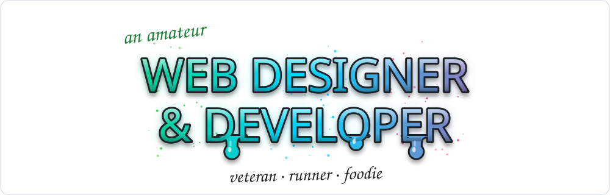
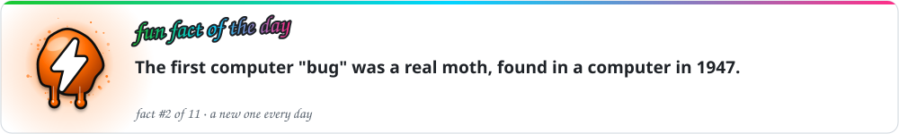
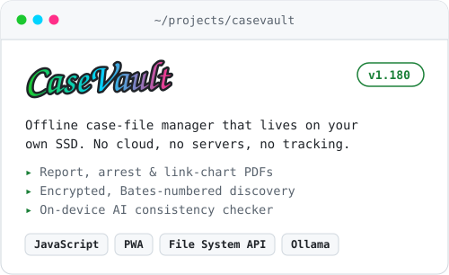
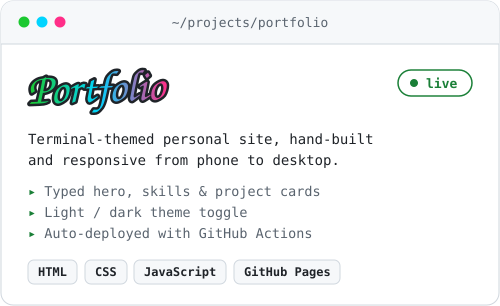

<!-- BANNER (regenerate with: python3 scripts/make_banner.py) -->
<picture>
  <source media="(prefers-color-scheme: dark)" srcset="assets/banner-dark.svg" />
  
</picture>

<!-- VISITOR COUNTER -->

  

 

<!-- HEADLINE (regenerate with: python3 scripts/make_graffiti.py) -->
<picture>
  <source media="(prefers-color-scheme: dark)" srcset="assets/headline-dark.svg" />
  
</picture>

<!-- TERMINAL (regenerate with: python3 scripts/make_projects.py) -->
<picture>
  <source media="(prefers-color-scheme: dark)" srcset="assets/terminal-dark.svg" />
  
</picture>

<!-- ABOUT ME (icons are made by scripts/make_graffiti.py) -->

  <table>
    <tr>
      <td></td>
      <td align="left"><b>Working on</b></td>
      <td align="left"><a href="https://github.com/t3rminal-cmd/casevault">CaseVault</a> — offline case files + local AI</td>
    </tr>
    <tr>
      <td></td>
      <td align="left"><b>Learning</b></td>
      <td align="left">HTML · CSS · JavaScript · Python</td>
    </tr>
    <tr>
      <td></td>
      <td align="left"><b>Ask me about</b></td>
      <td align="left">Coffee, snowboarding or C4 energy drinks</td>
    </tr>
  </table>

<!-- FUN FACT (a new card every day, built by scripts/fun_fact.py).
     "?v=2" makes GitHub's image cache fetch the new card design; bump it if a
     design change doesn't show up. Daily fact changes don't need it. -->

  <picture>
    <source media="(prefers-color-scheme: dark)" srcset="https://raw.githubusercontent.com/t3rminal-cmd/t3rminal-cmd/output/fun-fact-dark.svg?v=2" />
    
  </picture>

<!-- LATEST PROJECTS (cards are made by scripts/make_projects.py) -->
<h3 align="center">Latest Projects:</h3>

  <a href="https://github.com/t3rminal-cmd/casevault" title="CaseVault on GitHub">
    <picture>
      <source media="(prefers-color-scheme: dark)" srcset="assets/project-casevault-dark.svg" />
      
    </picture></a>
  <a href="https://t3rminal-cmd.github.io/Portfolio-Bootstrap/" title="Open my portfolio">
    <picture>
      <source media="(prefers-color-scheme: dark)" srcset="assets/project-portfolio-dark.svg" />
      
    </picture></a>

<!-- MY STATS -->
<h3 align="center">My Stats:</h3>

    <picture>
      <source media="(prefers-color-scheme: dark)" srcset="https://raw.githubusercontent.com/t3rminal-cmd/t3rminal-cmd/output/stats-dark.svg" />
      
    </picture>
    <picture>
      <source media="(prefers-color-scheme: dark)" srcset="https://raw.githubusercontent.com/t3rminal-cmd/t3rminal-cmd/output/top-langs-dark.svg" />
      
    </picture>

<!-- CONTRIBUTION CHART (built by scripts/contrib_graph.py) -->
<h3 align="center">Contribution Activity:</h3>

  <picture>
    <source media="(prefers-color-scheme: dark)"
      srcset="https://raw.githubusercontent.com/t3rminal-cmd/t3rminal-cmd/output/contrib-dark.svg" />
    
  </picture>

<!-- CONNECT (icons are made by scripts/make_graffiti.py) -->
<h3 align="center">Connect with me:</h3>

  &nbsp;&nbsp;
  &nbsp;&nbsp;
  

